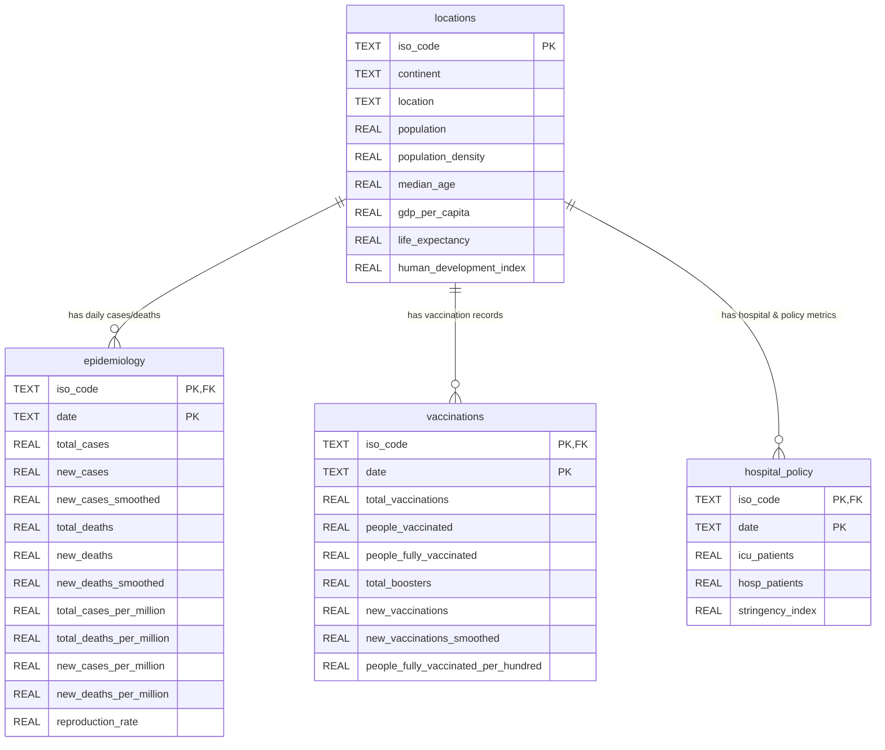

# ER-диаграмма базы данных SQLite (`covid.db`)

Схема нормализована в 3NF: статические атрибуты стран вынесены в справочник `locations`, а ежедневные наблюдения разделены по доменам на 3 таблицы фактов с составным первичным ключом `(iso_code, date)` и внешним ключом на `locations(iso_code)`.

